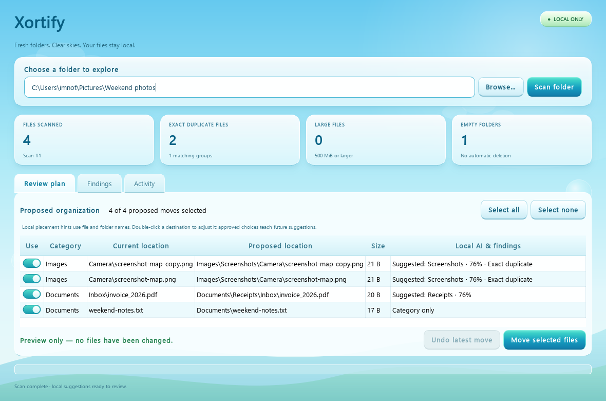

# Xortify

Xortify is a local-first Windows desktop organizer for reviewing a folder, grouping recognizable photos, and cleaning up loose files. It proposes changes first. Nothing moves until you select and approve the plan.

## v0.1

- Scans a selected folder in the background without changing it.
- Categorizes files as Images, Videos, Documents, Audio, Archives, Code, Installers, or Other using signatures, extensions, and local metadata.
- Finds exact duplicates with SHA-256 and reports empty folders, large files, and unreadable items.
- Optionally downloads a 5 MB image model. After that one download, image analysis runs offline on the PC.
- Groups familiar photo subjects into broad collections such as Cats, Dogs, Birds, Animals, Food, Vehicles, Nature, and Sports. A cat photo can be grouped with other cat photos even when they started in different folders.
- Detects common code project folders and proposes moving each complete folder as one unit. It never sorts project files such as Python or DLL files out of a recognized project.
- Shows a review plan with selection switches and editable destinations before any move.
- Verifies selected files and project folders again before moving, avoids destination collisions, records operations in SQLite, and supports undo.
- Stores scan history and approved placement examples locally.

Scanning and preview are read-only. Xortify does not delete files or empty directories. Photo contents are never uploaded. The image weights download only when you press the install button.

## UI preview

## Windows setup

Use 64-bit Python 3.10 or newer.

~~~powershell
cd "$env:USERPROFILE\OneDrive\Desktop\Xortify"
py -m venv .venv
.\.venv\Scripts\Activate.ps1
python -m pip install --upgrade pip
python -m pip install -e ".[dev,vision]"
python -m xortify
~~~

The vision extra installs ONNX Runtime, NumPy, and Pillow. The model itself is downloaded inside Xortify when you choose Download image AI. It is stored under %LOCALAPPDATA%\Xortify\models.

## Build a Windows executable

Install the build dependencies once, then run the PowerShell build script:

~~~powershell
python -m pip install -e ".[dev,vision,build]"
powershell -ExecutionPolicy Bypass -File .\packaging\build_windows.ps1
~~~

The single-file app is written to `dist\Xortify.exe`. It includes the local image inference runtime; the 5 MB model weights remain a separate download from inside the app to keep the executable smaller.

## Tests

~~~powershell
python -m pytest
~~~

The tests use temporary folders and databases. They cover scan safety, classification, project-folder moves and undo, destination collisions, AI topic mapping, and the downloaded model when it is present.

## Local data and privacy

- The SQLite database is stored at %LOCALAPPDATA%\Xortify\xortify.sqlite3.
- Model files are stored at %LOCALAPPDATA%\Xortify\models.
- Xortify sends no selected file, filename, photo, hash, or scan result to a server.
- Installing the optional model requires an internet connection once. The weights are downloaded from Hugging Face, checked against a fixed SHA-256 digest, then used locally by ONNX Runtime on the CPU.

## What AI is in v0.1

The photo model is MediaPipe EfficientNet-Lite0 INT8/UINT8, converted to ONNX by KETI Software Platform Team. The weight file is 5,148,096 bytes (about 4.91 MiB). It predicts one of 1,000 ImageNet labels, then Xortify maps suitable labels to broad review folders. The model is a small image classifier, not a chat model or a general-purpose reasoning model.

If the model is missing or its prediction is unclear, Xortify uses its local filename/folder-name rules instead. The rules and approved-placement learner can suggest places for non-image files. The image model does not understand videos, document meaning, OCR, faces, custom natural-language categories, or arbitrary scenes.

The model card lists Apache 2.0 for the converted weights. The upstream ImageNet access terms are separate and state non-commercial research/education restrictions for dataset access. Treat this checkpoint as a prototype until commercial rights are reviewed or a commercially cleared replacement is selected. See THIRD_PARTY_NOTICES.md.

## Limits

- Image categories are broad guesses from the model's fixed label set. Review them before moving.
- Video scene recognition, document understanding, OCR, face recognition, and custom visual categories are future work.
- Project detection uses common manifest/repository markers. A folder without those markers may not be recognized as a project.
- Exact duplicate files are reported, never removed automatically.
- Empty folders are reported, never deleted automatically.
- Undo depends on the moved item and SQLite journal remaining available. It never overwrites an occupied original name.
- A model trained or obtained under an unclear commercial license must not be shipped in a paid build until cleared.

See docs/TECHNICAL_SPEC.md and docs/PRODUCT_AND_REVENUE_ROADMAP.md.
